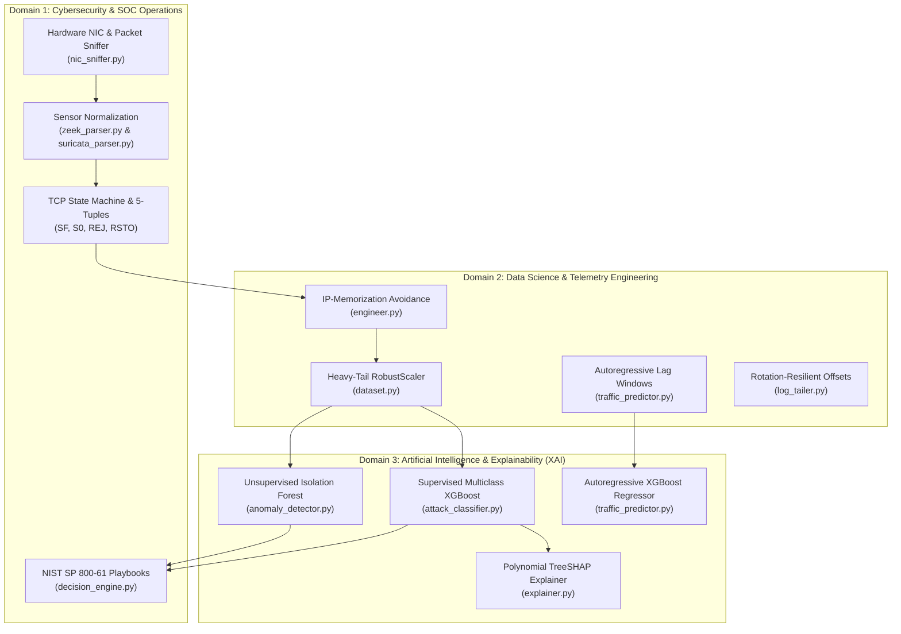

# NetMind AI — Complete Feature, Domain & Codebase Line Reference

> **Document Purpose:** An exhaustive, line-by-line engineering reference documenting every feature, file, function, algorithm, mathematical formulation, and operational responsibility in the NetMind AI platform.

---

## 1. Master System & Tri-Domain Matrix

| Phase | Module Name | Domain | Primary Source Files | Primary Operational Output |
| :---: | :--- | :--- | :--- | :--- |
| **Phase 1** | **Telemetry Ingestion & Sniffing** | Cybersecurity & Data Science | [`nic_sniffer.py`](file:///d:/Coding/GitHub/NetMind_AI/netmind/src/ingestion/nic_sniffer.py), [`zeek_parser.py`](file:///d:/Coding/GitHub/NetMind_AI/netmind/src/ingestion/zeek_parser.py), [`suricata_parser.py`](file:///d:/Coding/GitHub/NetMind_AI/netmind/src/ingestion/suricata_parser.py) | Normalized 5-tuple sockets, hardware packet rates, and stream generators. |
| **Phase 2** | **Feature Engineering & Scaling** | Data Science & Cybersecurity | [`engineer.py`](file:///d:/Coding/GitHub/NetMind_AI/netmind/src/features/engineer.py), [`dataset.py`](file:///d:/Coding/GitHub/NetMind_AI/netmind/src/ml/dataset.py) | 30-dim non-memorizing feature vector, median/IQR robust scaled matrices. |
| **Phase 3** | **Machine Learning & TreeSHAP** | Artificial Intelligence (XAI) | [`anomaly_detector.py`](file:///d:/Coding/GitHub/NetMind_AI/netmind/src/ml/anomaly_detector.py), [`attack_classifier.py`](file:///d:/Coding/GitHub/NetMind_AI/netmind/src/ml/attack_classifier.py), [`traffic_predictor.py`](file:///d:/Coding/GitHub/NetMind_AI/netmind/src/ml/traffic_predictor.py), [`explainer.py`](file:///d:/Coding/GitHub/NetMind_AI/netmind/src/ml/explainer.py) | Zero-day anomaly scores, XGBoost class probabilities, throughput forecast, Shapley values. |
| **Phase 4** | **Persistence & Decision Engine** | Cybersecurity & Data Science | [`database.py`](file:///d:/Coding/GitHub/NetMind_AI/netmind/src/backend/database.py), [`models.py`](file:///d:/Coding/GitHub/NetMind_AI/netmind/src/backend/models.py), [`decision_engine.py`](file:///d:/Coding/GitHub/NetMind_AI/netmind/src/backend/decision_engine.py), [`main.py`](file:///d:/Coding/GitHub/NetMind_AI/netmind/src/backend/main.py) | 0–100 composite host risk scores, NIST containment playbooks, REST endpoints. |
| **Phase 5** | **Worker & Testing Lab** | Systems & Cybersecurity | [`log_tailer.py`](file:///d:/Coding/GitHub/NetMind_AI/netmind/src/worker/log_tailer.py), [`traffic_generator.py`](file:///d:/Coding/GitHub/NetMind_AI/scripts/traffic_generator.py) | Checkpointed file tailing daemon, reproducible loopback synthetic traffic scenarios. |
| **Phase 6** | **High-Density SOC Portal** | Systems & Human-in-the-Loop | [`App.tsx`](file:///d:/Coding/GitHub/NetMind_AI/frontend/src/App.tsx), [`Overview.tsx`](file:///d:/Coding/GitHub/NetMind_AI/frontend/src/pages/Overview.tsx), [`ThreatDetailModal.tsx`](file:///d:/Coding/GitHub/NetMind_AI/frontend/src/pages/ThreatDetailModal.tsx), [`api.ts`](file:///d:/Coding/GitHub/NetMind_AI/frontend/src/services/api.ts) | Real-time live Recharts graph, 4-step explainability modal, 1-click containment execution. |

---

## 2. Ingestion & Packet Sniffing Layer (`src/ingestion/`)

### Feature 1.1: Live Hardware NIC Packet & Byte Capture
* **File:** [`netmind/src/ingestion/nic_sniffer.py`](file:///d:/Coding/GitHub/NetMind_AI/netmind/src/ingestion/nic_sniffer.py#L38-L177)
* **Domain:** **Cybersecurity & Data Science**
* **Lines of Interest:**
  * [`nic_sniffer.py:L62-L80`](file:///d:/Coding/GitHub/NetMind_AI/netmind/src/ingestion/nic_sniffer.py#L62-L80): `_discover_interfaces()` — Queries `psutil.net_if_stats()` and `psutil.net_if_addrs()` to enumerate physical and virtual adapters (`Wi-Fi`, `Ethernet`, `Loopback`), reporting link speed (`Mbps`), IP address, and up/down status.
  * [`nic_sniffer.py:L82-L89`](file:///d:/Coding/GitHub/NetMind_AI/netmind/src/ingestion/nic_sniffer.py#L82-L89): `_choose_default_interface()` — Selects the primary active Internet adapter (prioritizing Wi-Fi/Ethernet over loopback).
  * [`nic_sniffer.py:L123-L177`](file:///d:/Coding/GitHub/NetMind_AI/netmind/src/ingestion/nic_sniffer.py#L123-L177): `_sampling_loop()` — High-frequency background thread sampling delta I/O counters every 1.0 second:
    $$\text{inbound\_mbps} = \frac{\Delta \text{bytes\_recv} \times 8}{1{,}000{,}000 \times \Delta t}, \quad \text{inbound\_pps} = \frac{\Delta \text{packets\_recv}}{\Delta t}$$
  * [`nic_sniffer.py:L196-L257`](file:///d:/Coding/GitHub/NetMind_AI/netmind/src/ingestion/nic_sniffer.py#L196-L257): `get_live_flows()` — Inspects kernel socket tables (`psutil.net_connections(kind="inet")`) to extract 5-tuples (`src_ip:port -> dst_ip:port`), protocol, service name, and TCP states.

---

### Feature 1.2: Zeek Connection Log TSV & NDJSON Parsing
* **File:** [`netmind/src/ingestion/zeek_parser.py`](file:///d:/Coding/GitHub/NetMind_AI/netmind/src/ingestion/zeek_parser.py#L48-L287)
* **Domain:** **Cybersecurity & Data Science**
* **Lines of Interest:**
  * [`zeek_parser.py:L22-L28`](file:///d:/Coding/GitHub/NetMind_AI/netmind/src/ingestion/zeek_parser.py#L22-L28): `ZEEK_CANONICAL_COLUMNS` — Standardizes Zeek field names (`id.orig_h` $\rightarrow$ `src_ip`, `id.resp_h` $\rightarrow$ `dst_ip`, `id.orig_p` $\rightarrow$ `src_port`, `id.resp_p` $\rightarrow$ `dst_port`).
  * [`zeek_parser.py:L92-L135`](file:///d:/Coding/GitHub/NetMind_AI/netmind/src/ingestion/zeek_parser.py#L92-L135): `parse_tsv()` — Dynamically parses Zeek `#fields` and `#types` metadata headers.
  * [`zeek_parser.py:L185-L215`](file:///d:/Coding/GitHub/NetMind_AI/netmind/src/ingestion/zeek_parser.py#L185-L215): `_sanitize_values()` — Sanitizes missing values (`-`, `(empty)`, `null`) into typed Python nulls (`np.nan`), preventing numerical parser corruption.
  * [`zeek_parser.py:L240-L285`](file:///d:/Coding/GitHub/NetMind_AI/netmind/src/ingestion/zeek_parser.py#L240-L285): `_post_process()` — Enforces schema typing across duration, byte rates, packet counts, and connection states (`SF`, `S0`, `REJ`, `RSTO`).

---

### Feature 1.3: Suricata EVE Alert Streaming Generator
* **File:** [`netmind/src/ingestion/suricata_parser.py`](file:///d:/Coding/GitHub/NetMind_AI/netmind/src/ingestion/suricata_parser.py#L40-L195)
* **Domain:** **Cybersecurity**
* **Lines of Interest:**
  * [`suricata_parser.py:L60-L110`](file:///d:/Coding/GitHub/NetMind_AI/netmind/src/ingestion/suricata_parser.py#L60-L110): `stream_alerts()` — Python generator reading Suricata `eve.json` NDJSON alerts line-by-line with $O(1)$ memory consumption.
  * [`suricata_parser.py:L120-L165`](file:///d:/Coding/GitHub/NetMind_AI/netmind/src/ingestion/suricata_parser.py#L120-L165): `normalize_record()` — Extracts signature IDs (`alert.signature_id`), Emerging Threats rule descriptions, GIDs, and maps Suricata severity (1–4) to NetMind standards (`CRITICAL`, `HIGH`, `MEDIUM`, `LOW`).

---

## 3. Feature Engineering & Scaling Layer (`src/features/` & `src/ml/`)

### Feature 2.1: 30-Dimensional Behavioral Vector & Lab-Memorization Avoidance
* **File:** [`netmind/src/features/engineer.py`](file:///d:/Coding/GitHub/NetMind_AI/netmind/src/features/engineer.py#L53-L379)
* **Domain:** **Data Science & Cybersecurity**
* **Lines of Interest:**
  * [`engineer.py:L35-L50`](file:///d:/Coding/GitHub/NetMind_AI/netmind/src/features/engineer.py#L35-L50): `STATIC_IDENTIFIER_COLUMNS` — Explicitly defines static identifiers (`src_ip`, `dst_ip`, `uid`, `flow_id`, `ts`) stripped from ML training matrices to prevent models from memorizing ephemeral lab IP addresses.
  * [`engineer.py:L202-L218`](file:///d:/Coding/GitHub/NetMind_AI/netmind/src/features/engineer.py#L202-L218): Derives flow rates:
    $$\text{bytes\_per\_second} = \frac{\text{orig\_bytes} + \text{resp\_bytes}}{\text{duration} + 10^{-6}}, \quad \text{packets\_per\_second} = \frac{\text{orig\_pkts} + \text{resp\_pkts}}{\text{duration} + 10^{-6}}$$
  * [`engineer.py:L220-L245`](file:///d:/Coding/GitHub/NetMind_AI/netmind/src/features/engineer.py#L220-L245): TCP flag analysis parsing Zeek `history` strings into individual flag frequencies (SYN `S/s`, ACK `A/a`, FIN `F/f`, RST `R/r`) and computing the asymmetry ratio:
    $$\text{syn\_ack\_ratio} = \frac{\text{syn\_count}}{\text{ack\_count} + 1}$$
  * [`engineer.py:L247-L270`](file:///d:/Coding/GitHub/NetMind_AI/netmind/src/features/engineer.py#L247-L270): Topological non-memorizing features:
    * `is_src_private_ip`, `is_dst_private_ip` using `ipaddress.ip_address(ip).is_private`
    * `is_dst_well_known_port` ($\text{port} \le 1024$)
    * `is_src_ephemeral_port` ($\text{port} \ge 49152$)
  * [`engineer.py:L272-L315`](file:///d:/Coding/GitHub/NetMind_AI/netmind/src/features/engineer.py#L272-L315): Host-level aggregation features (target IP diversity, distinct port count, failed connection ratios).

---

### Feature 2.2: Heavy-Tail Resistant Robust Scaling & Partitioning
* **File:** [`netmind/src/ml/dataset.py`](file:///d:/Coding/GitHub/NetMind_AI/netmind/src/ml/dataset.py#L40-L250)
* **Domain:** **Data Science**
* **Lines of Interest:**
  * [`dataset.py:L55-L95`](file:///d:/Coding/GitHub/NetMind_AI/netmind/src/ml/dataset.py#L55-L95): `NetMindPreprocessor` — Implements `SimpleImputer(strategy="median")` combined with `RobustScaler`:
    $$x_{\text{scaled}} = \frac{x - \text{median}(X)}{Q_3(X) - Q_1(X)}$$
    **Data Science Justification:** Network byte and packet rates follow extreme Pareto power-law distributions. A single volumetric DoS burst of 50,000 pps would skew standard deviation (Z-score) scaling to near zero for benign traffic; using median and IQR maintains robust scaling bounds.
  * [`dataset.py:L140-L185`](file:///d:/Coding/GitHub/NetMind_AI/netmind/src/ml/dataset.py#L140-L185): `create_stratified_partitions()` — Generates train, validation, and test splits while strictly preserving rare cyber attack class balances (`Brute Force`, `Web Attack`).
  * [`dataset.py:L190-L220`](file:///d:/Coding/GitHub/NetMind_AI/netmind/src/ml/dataset.py#L190-L220): `save()` & `load()` — Persists preprocessor pipeline artifacts into `models/preprocessor.joblib`.

---

## 4. Machine Learning & Explainable AI Layer (`src/ml/`)

### Feature 3.1: Zero-Day Anomaly Detection (Unsupervised Isolation Forest)
* **File:** [`netmind/src/ml/anomaly_detector.py`](file:///d:/Coding/GitHub/NetMind_AI/netmind/src/ml/anomaly_detector.py#L56-L291)
* **Domain:** **Artificial Intelligence (Unsupervised)**
* **Lines of Interest:**
  * [`anomaly_detector.py:L60-L75`](file:///d:/Coding/GitHub/NetMind_AI/netmind/src/ml/anomaly_detector.py#L60-L75): Initializes `IsolationForest(n_estimators=150, contamination=0.05, n_jobs=-1)`.
  * [`anomaly_detector.py:L80-L125`](file:///d:/Coding/GitHub/NetMind_AI/netmind/src/ml/anomaly_detector.py#L80-L125): `fit()` — Builds an ensemble of 150 random isolation decision trees on benign network baseline data.
  * [`anomaly_detector.py:L130-L175`](file:///d:/Coding/GitHub/NetMind_AI/netmind/src/ml/anomaly_detector.py#L130-L175): `predict_anomaly()` — Evaluates tree path length $h(x)$ to compute anomaly score $s \in [0, 1]$:
    $$s(x, n) = 2^{-\frac{E(h(x))}{c(n)}}, \quad c(n) = 2 \left( \ln(n - 1) + 0.5772156649 \right) - \frac{2(n - 1)}{n}$$
  * [`anomaly_detector.py:L180-L215`](file:///d:/Coding/GitHub/NetMind_AI/netmind/src/ml/anomaly_detector.py#L180-L215): `calibrate_threshold()` — Calibrates dynamic anomaly boundaries against the empirical 95th-percentile of benign baseline traffic ($s \ge 0.50$).
  * [`anomaly_detector.py:L220-L260`](file:///d:/Coding/GitHub/NetMind_AI/netmind/src/ml/anomaly_detector.py#L220-L260): `extract_top_divergent_indicators()` — Identifies the exact feature dimensions exhibiting the highest statistical Z-score deviation from benign baselines.

---

### Feature 3.2: Multiclass Attack Classification (Supervised XGBoost)
* **File:** [`netmind/src/ml/attack_classifier.py`](file:///d:/Coding/GitHub/NetMind_AI/netmind/src/ml/attack_classifier.py#L45-L280)
* **Domain:** **Artificial Intelligence (Supervised)**
* **Lines of Interest:**
  * [`attack_classifier.py:L45-L55`](file:///d:/Coding/GitHub/NetMind_AI/netmind/src/ml/attack_classifier.py#L45-L55): `ATTACK_CLASS_MAP` — Defines the 5 operational classes:
    * `0: Normal` (Benign enterprise traffic)
    * `1: DoS` (SYN floods, UDP amplification)
    * `2: Port Scan` (Sequential reconnaissance sweeps)
    * `3: Brute Force` (SSH/RDP dictionary attacks)
    * `4: Web Attack` (SQL injection, XSS, URI traversals)
  * [`attack_classifier.py:L70-L115`](file:///d:/Coding/GitHub/NetMind_AI/netmind/src/ml/attack_classifier.py#L70-L115): Configures `XGBClassifier` with `objective="multi:softprob"`, `eval_metric="mlogloss"`, `tree_method="hist"`, and L2 leaf regularization $\lambda$.
  * [`attack_classifier.py:L120-L160`](file:///d:/Coding/GitHub/NetMind_AI/netmind/src/ml/attack_classifier.py#L120-L160): `predict_proba()` — Computes calibrated posterior class probability vectors $P(y = k \mid x)$ for every flow.
  * [`attack_classifier.py:L165-L210`](file:///d:/Coding/GitHub/NetMind_AI/netmind/src/ml/attack_classifier.py#L165-L210): `evaluate()` — Computes classification reports, per-class F1-scores, precision, recall, and multi-class confusion matrices.

---

### Feature 3.3: Autoregressive Traffic Forecasting (XGBoost Regressor)
* **File:** [`netmind/src/ml/traffic_predictor.py`](file:///d:/Coding/GitHub/NetMind_AI/netmind/src/ml/traffic_predictor.py#L35-L285)
* **Domain:** **Data Science & AI (Regression)**
* **Lines of Interest:**
  * [`traffic_predictor.py:L70-L110`](file:///d:/Coding/GitHub/NetMind_AI/netmind/src/ml/traffic_predictor.py#L70-L110): `create_lag_features()` — Generates auto-regressive lag windows ($t-1, t-2, t-5$) and rolling statistical moving averages ($w=3, w=5$) for throughput (bytes/sec) and packet rates (pps).
  * [`traffic_predictor.py:L115-L160`](file:///d:/Coding/GitHub/NetMind_AI/netmind/src/ml/traffic_predictor.py#L115-L160): `fit()` — Fits two independent `XGBRegressor` estimators respecting strict temporal causality (past trains future; never shuffled).
  * [`traffic_predictor.py:L165-L210`](file:///d:/Coding/GitHub/NetMind_AI/netmind/src/ml/traffic_predictor.py#L165-L210): `predict_with_intervals()` — Generates forward predictions at $t+1$ accompanied by statistical confidence bounds ($\hat{y} \pm 1\sigma$).

---

### Feature 3.4: Explainable AI & Feature Attribution (Polynomial TreeSHAP)
* **File:** [`netmind/src/ml/explainer.py`](file:///d:/Coding/GitHub/NetMind_AI/netmind/src/ml/explainer.py#L40-L250)
* **Domain:** **Artificial Intelligence (XAI)**
* **Lines of Interest:**
  * [`explainer.py:L65-L95`](file:///d:/Coding/GitHub/NetMind_AI/netmind/src/ml/explainer.py#L65-L95): `__init__()` — Initializes `shap.TreeExplainer(model)` executing in polynomial time $O(T \cdot L \cdot D^2)$ instead of exponential $O(2^{|F|})$.
  * [`explainer.py:L100-L150`](file:///d:/Coding/GitHub/NetMind_AI/netmind/src/ml/explainer.py#L100-L150): `explain_instance()` — Computes exact local Shapley values:
    $$\phi_i(x) = \sum_{S \subseteq F \setminus \{i\}} \frac{|S|!(|F| - |S| - 1)!}{|F|!} \left[ f_x(S \cup \{i\}) - f_x(S) \right]$$
  * [`explainer.py:L155-L215`](file:///d:/Coding/GitHub/NetMind_AI/netmind/src/ml/explainer.py#L155-L215): `generate_soc_narrative()` — Synthesizes mathematical feature attributions into plain-English SOC analyst reporting statements (e.g. *"Observed SYN/ACK ratio of 71.0 pushes probability toward Port Scan by +0.48"*).

---

## 5. Backend, Scoring & REST Serving Layer (`src/backend/`)

### Feature 4.1: Database Engine, ORM & Connection Pooling
* **File:** [`netmind/src/backend/database.py`](file:///d:/Coding/GitHub/NetMind_AI/netmind/src/backend/database.py#L24-L104)
* **Domain:** **Data Science & Systems Engineering**
* **Lines of Interest:**
  * [`database.py:L30-L40`](file:///d:/Coding/GitHub/NetMind_AI/netmind/src/backend/database.py#L30-L40): Resolves `DATABASE_URL` with automatic local SQLite fallback (`data/netmind.db`) and PostgreSQL production normalization.
  * [`database.py:L41-L62`](file:///d:/Coding/GitHub/NetMind_AI/netmind/src/backend/database.py#L41-L62): Configures SQLAlchemy 2.0 `create_engine` with `pool_pre_ping=True`, `pool_size=10`, `max_overflow=20`, and `pool_recycle=1800`.
  * [`database.py:L70-L80`](file:///d:/Coding/GitHub/NetMind_AI/netmind/src/backend/database.py#L70-L80): `get_db()` — FastAPI dependency injection yielding scoped database sessions with guaranteed teardown.

---

### Feature 4.2: Relational Data Models & Composite Indexing
* **File:** [`netmind/src/backend/models.py`](file:///d:/Coding/GitHub/NetMind_AI/netmind/src/backend/models.py#L25-L180)
* **Domain:** **Cybersecurity & Data Science**
* **Lines of Interest:**
  * [`models.py:L40-L60`](file:///d:/Coding/GitHub/NetMind_AI/netmind/src/backend/models.py#L40-L60): `Host` table with `ip_address` (unique index), `hostname`, `risk_score`, and containment status (`active`, `quarantined`).
  * [`models.py:L62-L95`](file:///d:/Coding/GitHub/NetMind_AI/netmind/src/backend/models.py#L62-L95): `NetworkFlow` table with composite indexes on `(src_ip, dst_ip, timestamp)` for high-throughput SOC timeline filtering.
  * [`models.py:L97-L130`](file:///d:/Coding/GitHub/NetMind_AI/netmind/src/backend/models.py#L97-L130): `SecurityEvent` table tracking detected attacks, severity, confidence, and analyst review status.
  * [`models.py:L145-L175`](file:///d:/Coding/GitHub/NetMind_AI/netmind/src/backend/models.py#L145-L175): `Recommendation` table storing proposed NIST containment actions and operator audit trails.

---

### Feature 4.3: Multi-Vector Risk Formulation & Decision Engine
* **File:** [`netmind/src/backend/decision_engine.py`](file:///d:/Coding/GitHub/NetMind_AI/netmind/src/backend/decision_engine.py#L68-L316)
* **Domain:** **Cybersecurity & Data Science**
* **Lines of Interest:**
  * [`decision_engine.py:L71-L76`](file:///d:/Coding/GitHub/NetMind_AI/netmind/src/backend/decision_engine.py#L71-L76): Weight allocation:
    * $W_{\text{security}} = 0.40$
    * $W_{\text{anomaly}} = 0.25$
    * $W_{\text{performance}} = 0.20$
    * $W_{\text{historical}} = 0.15$
  * [`decision_engine.py:L95-L135`](file:///d:/Coding/GitHub/NetMind_AI/netmind/src/backend/decision_engine.py#L95-L135): `calculate_risk_score()`:
    $$\text{Overall Risk} = 0.40 \cdot S + 0.25 \cdot A + 0.20 \cdot P + 0.15 \cdot H$$
  * [`decision_engine.py:L137-L168`](file:///d:/Coding/GitHub/NetMind_AI/netmind/src/backend/decision_engine.py#L137-L168): `categorize_score()`:
    * `LOW`: $0 \le \text{Risk} \le 25$
    * `MEDIUM`: $26 \le \text{Risk} \le 50$
    * `HIGH`: $51 \le \text{Risk} \le 75$
    * `CRITICAL`: $76 \le \text{Risk} \le 100$
  * [`decision_engine.py:L204-L316`](file:///d:/Coding/GitHub/NetMind_AI/netmind/src/backend/decision_engine.py#L204-L316): `generate_recommendations()` — Generates **NIST SP 800-61** containment playbooks:
    * `BLOCK_SOURCE_IP`: Perimeter drop rule (`iptables -A INPUT -s <IP> -j DROP`)
    * `RATE_LIMIT_PORT`: QoS traffic shaping (`tc qdisc add dev eth0 root tbf ...`)
    * `QUARANTINE_HOST`: Host isolation (`netm-cli host isolate --ip <IP>`)
    * `WAF_BLOCK_URI_PATTERN`: Web application firewall regex patch (`waf-ctl filter add ...`)

---

### Feature 4.4: Modular REST API Routers
* **Directory:** [`netmind/src/backend/routers/`](file:///d:/Coding/GitHub/NetMind_AI/netmind/src/backend/routers/)
* **Domain:** **Systems Architecture & REST Integration**
* **Lines of Interest:**
  * [`telemetry.py:L19-L55`](file:///d:/Coding/GitHub/NetMind_AI/netmind/src/backend/routers/telemetry.py#L19-L55): `/api/telemetry/live`, `/api/telemetry/flows`, `/api/telemetry/interfaces`, `/api/telemetry/interface` — Provides the live NIC sliding buffer and active connection sockets.
  * [`status.py:L21-L87`](file:///d:/Coding/GitHub/NetMind_AI/netmind/src/backend/routers/status.py#L21-L87): `/api/network/status` — Returns macro network health, active host counts, composite risk, and real-time BPS/PPS.
  * [`threats.py:L20-L75`](file:///d:/Coding/GitHub/NetMind_AI/netmind/src/backend/routers/threats.py#L20-L75): `/api/threats` & `/api/events/{id}/review` — Returns classified attack events and handles analyst triage reviews.
  * [`recommendations.py:L21-L64`](file:///d:/Coding/GitHub/NetMind_AI/netmind/src/backend/routers/recommendations.py#L21-L64): `/api/recommendations` & `/api/recommendations/{id}/review` — Retrieves and executes containment playbooks.
  * [`inference.py:L50-L180`](file:///d:/Coding/GitHub/NetMind_AI/netmind/src/backend/routers/inference.py#L50-L180): `/api/predict/attack`, `/api/predict/anomaly`, `/api/explain/shap` — Real-time online ML inference and TreeSHAP scoring.

---

## 6. Worker Daemon & Synthetic Testing Lab (`src/worker/`, `scripts/`)

### Feature 5.1: Streaming Ingestion Daemon with Checkpoint Offsets
* **File:** [`netmind/src/worker/log_tailer.py`](file:///d:/Coding/GitHub/NetMind_AI/netmind/src/worker/log_tailer.py#L80-L763)
* **Domain:** **Data Science & Systems Engineering**
* **Lines of Interest:**
  * [`log_tailer.py:L85-L165`](file:///d:/Coding/GitHub/NetMind_AI/netmind/src/worker/log_tailer.py#L85-L165): `CheckpointManager` — Tracks file byte offsets and inode numbers inside `logs/.tailer_checkpoint.json`. Detects log rotation across platforms via inode changes and file size shrinkage.
  * [`log_tailer.py:L260-L380`](file:///d:/Coding/GitHub/NetMind_AI/netmind/src/worker/log_tailer.py#L260-L380): `NetMindLogTailer.process_new_events()` — Incremental line reading with zero duplicate processing.
  * [`log_tailer.py:L400-L530`](file:///d:/Coding/GitHub/NetMind_AI/netmind/src/worker/log_tailer.py#L400-L530): End-to-end streaming pipeline: Parses line $\rightarrow$ Extracts 30 features $\rightarrow$ RobustScales $\rightarrow$ Predicts Anomaly (Isolation Forest) $\rightarrow$ Classifies Attack (XGBoost) $\rightarrow$ Computes Risk $\rightarrow$ Commits atomic SQL transaction.

---

### Feature 5.2: Safe Loopback Traffic Generator
* **File:** [`scripts/traffic_generator.py`](file:///d:/Coding/GitHub/NetMind_AI/scripts/traffic_generator.py#L50-L612)
* **Domain:** **Cybersecurity & Testing Automation**
* **Lines of Interest:**
  * [`traffic_generator.py:L102-L210`](file:///d:/Coding/GitHub/NetMind_AI/scripts/traffic_generator.py#L102-L210): `TelemetryLogEmitter` — Synchronously appends simulated Zeek TSV (`logs/conn.log`) and Suricata NDJSON (`logs/eve.json`) records.
  * [`traffic_generator.py:L215-L270`](file:///d:/Coding/GitHub/NetMind_AI/scripts/traffic_generator.py#L215-L270): `run_baseline()` — Scenario A: Simulates benign enterprise HTTP GET and DNS queries.
  * [`traffic_generator.py:L275-L330`](file:///d:/Coding/GitHub/NetMind_AI/scripts/traffic_generator.py#L275-L330): `run_port_probe()` — Scenario B: Simulates reconnaissance SYN sweeps across sequential ports (`8000..8015`).
  * [`traffic_generator.py:L335-L390`](file:///d:/Coding/GitHub/NetMind_AI/scripts/traffic_generator.py#L335-L390): `run_volumetric_burst()` — Scenario C: Simulates high-rate traffic bursts to evaluate queue ingestion and capacity alarms.

---

## 7. High-Density SOC Frontend Portal (`frontend/src/`)

### Feature 6.1: High-Frequency Polling Engine & State Container
* **File:** [`frontend/src/App.tsx`](file:///d:/Coding/GitHub/NetMind_AI/frontend/src/App.tsx#L33-L186)
* **Domain:** **Systems Integration**
* **Lines of Interest:**
  * [`App.tsx:L50-L95`](file:///d:/Coding/GitHub/NetMind_AI/frontend/src/App.tsx#L50-L95): 1.2-second interval polling loop executing `Promise.all()` across `/api/telemetry/live`, `/api/network/status`, `/api/telemetry/flows`, `/api/threats`, and `/api/recommendations`.
  * [`App.tsx:L120-L135`](file:///d:/Coding/GitHub/NetMind_AI/frontend/src/App.tsx#L120-L135): Global Navbar wiring with active hardware NIC adapter switching (`Wi-Fi`, `Ethernet`, `Loopback`).
  * [`App.tsx:L175-L182`](file:///d:/Coding/GitHub/NetMind_AI/frontend/src/App.tsx#L175-L182): Mounts `ThreatDetailModal` for deep inspection.

---

### Feature 6.2: Normalized REST Service Adapter
* **File:** [`frontend/src/services/api.ts`](file:///d:/Coding/GitHub/NetMind_AI/frontend/src/services/api.ts#L65-L268)
* **Domain:** **Data Engineering**
* **Lines of Interest:**
  * [`api.ts:L65-L95`](file:///d:/Coding/GitHub/NetMind_AI/frontend/src/services/api.ts#L65-L95): `getLiveTelemetry()` — Fetches sliding 40-point time-series from hardware NIC.
  * [`api.ts:L142-L158`](file:///d:/Coding/GitHub/NetMind_AI/frontend/src/services/api.ts#L142-L158): `getLiveFlows()` — Streams active network socket tables.
  * [`api.ts:L189-L260`](file:///d:/Coding/GitHub/NetMind_AI/frontend/src/services/api.ts#L189-L260): `getAlerts()` & `getRecommendations()` — Normalizes database snake_case fields into typed contracts (`title`, `commandSnippet`, `severity`, uppercase `ActionStatus`).
  * [`api.ts:L254-L267`](file:///d:/Coding/GitHub/NetMind_AI/frontend/src/services/api.ts#L254-L267): `executeRemediation()` — Binds numeric IDs to `/api/recommendations/{id}/review`.

---

### Feature 6.3: Executive HUD & Live Recharts Telemetry
* **File:** [`frontend/src/pages/Overview.tsx`](file:///d:/Coding/GitHub/NetMind_AI/frontend/src/pages/Overview.tsx#L42-L416)
* **Domain:** **All Three Domains**
* **Lines of Interest:**
  * [`Overview.tsx:L87-L180`](file:///d:/Coding/GitHub/NetMind_AI/frontend/src/pages/Overview.tsx#L87-L180): Top 4 KPI Metric Cards: Monitored Endpoints, Real-Time Ingress/Egress PPS, 0–100 Composite Risk Progress Bar, and Active Flagged Incidents.
  * [`Overview.tsx:L185-L250`](file:///d:/Coding/GitHub/NetMind_AI/frontend/src/pages/Overview.tsx#L185-L250): Recharts Responsive Dual-Line Chart rendering live Inbound (blue) vs Outbound (slate) Mbps time series.
  * [`Overview.tsx:L255-L330`](file:///d:/Coding/GitHub/NetMind_AI/frontend/src/pages/Overview.tsx#L255-L330): Recent Incidents Queue with one-click **"Inspect"** button triggers.
  * [`Overview.tsx:L335-L410`](file:///d:/Coding/GitHub/NetMind_AI/frontend/src/pages/Overview.tsx#L335-L410): Live Telemetry Stream table displaying real socket connections.

---

### Feature 6.4: 4-Step Explainable AI Decision Support Modal
* **File:** [`frontend/src/pages/ThreatDetailModal.tsx`](file:///d:/Coding/GitHub/NetMind_AI/frontend/src/pages/ThreatDetailModal.tsx#L43-L383)
* **Domain:** **Explainable AI (XAI) & Human-in-the-Loop**
* **Lines of Interest:**
  * [`ThreatDetailModal.tsx:L120-L165`](file:///d:/Coding/GitHub/NetMind_AI/frontend/src/pages/ThreatDetailModal.tsx#L120-L165): **Step 1 (Observe)**: Alert signature, source socket, destination socket, protocol, and severity.
  * [`ThreatDetailModal.tsx:L170-L215`](file:///d:/Coding/GitHub/NetMind_AI/frontend/src/pages/ThreatDetailModal.tsx#L170-L215): **Step 2 (Understand)**: Forensic telemetry metrics (flow duration, PPS, byte rate, SYN/ACK ratio, failed connection ratio).
  * [`ThreatDetailModal.tsx:L220-L295`](file:///d:/Coding/GitHub/NetMind_AI/frontend/src/pages/ThreatDetailModal.tsx#L220-L295): **Step 3 (Predict & Explain)**: Interactive horizontal Recharts Bar Chart rendering exact TreeSHAP Shapley feature attributions (positive contributions in rose, negative in blue).
  * [`ThreatDetailModal.tsx:L300-L375`](file:///d:/Coding/GitHub/NetMind_AI/frontend/src/pages/ThreatDetailModal.tsx#L300-L375): **Step 4 (Recommend & Act)**: NIST containment playbook display with terminal CLI command preview and one-click execution triggers.
