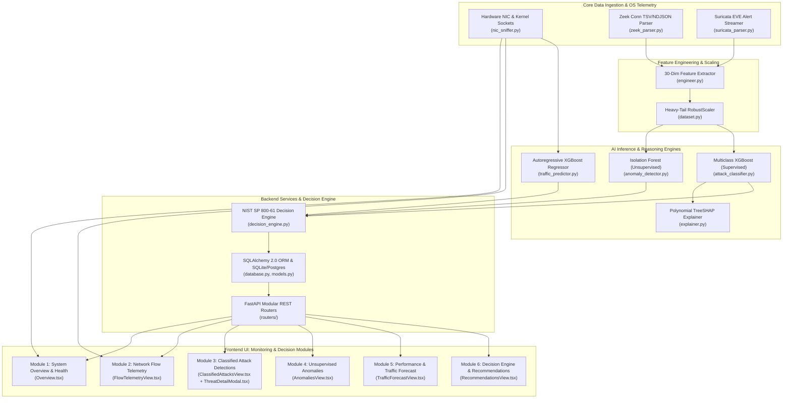

# NetMind AI — Monitoring & Decision Modules Engineering Reference

> **Document Purpose:** An exhaustive, line-by-line engineering and operational reference structured directly according to the **6 Monitoring & Decision Modules** in the NetMind AI Security Operations Center (SOC) console. This document specifies the exact domain, file paths, line number ranges, execution pipelines, data transformations, mathematical formulations, and operational responsibilities of each module across the full stack.

---

## Master Architecture & Module Index



---

## Quick Navigation: The 6 Monitoring & Decision Modules

| # | Sidebar Navigation Item | Primary Domain | Frontend Component | Core Engine / Processing File | REST Endpoint |
|---|---|---|---|---|---|
| **1** | [**System Overview & Health**](#module-1-system-overview--health) | Systems Engineering & Cybersecurity | [`Overview.tsx`](file:///d:/Coding/GitHub/NetMind_AI/frontend/src/pages/Overview.tsx) | [`nic_sniffer.py`](file:///d:/Coding/GitHub/NetMind_AI/netmind/src/ingestion/nic_sniffer.py), [`decision_engine.py`](file:///d:/Coding/GitHub/NetMind_AI/netmind/src/backend/decision_engine.py) | `/api/telemetry/live`, `/api/network/status` |
| **2** | [**Network Flow Telemetry**](#module-2-network-flow-telemetry) | Cybersecurity & Data Science | [`FlowTelemetryView.tsx`](file:///d:/Coding/GitHub/NetMind_AI/frontend/src/pages/FlowTelemetryView.tsx) | [`nic_sniffer.py`](file:///d:/Coding/GitHub/NetMind_AI/netmind/src/ingestion/nic_sniffer.py), [`zeek_parser.py`](file:///d:/Coding/GitHub/NetMind_AI/netmind/src/ingestion/zeek_parser.py) | `/api/telemetry/flows`, `/api/flows` |
| **3** | [**Classified Attack Detections**](#module-3-classified-attack-detections) | Artificial Intelligence (Supervised) & XAI | [`ClassifiedAttacksView.tsx`](file:///d:/Coding/GitHub/NetMind_AI/frontend/src/pages/ClassifiedAttacksView.tsx), [`ThreatDetailModal.tsx`](file:///d:/Coding/GitHub/NetMind_AI/frontend/src/pages/ThreatDetailModal.tsx) | [`attack_classifier.py`](file:///d:/Coding/GitHub/NetMind_AI/netmind/src/ml/attack_classifier.py), [`explainer.py`](file:///d:/Coding/GitHub/NetMind_AI/netmind/src/ml/explainer.py) | `/api/threats`, `/api/predict/attack`, `/api/explain/shap` |
| **4** | [**Unsupervised Anomalies**](#module-4-unsupervised-anomalies) | Artificial Intelligence (Unsupervised) & Data Science | [`AnomaliesView.tsx`](file:///d:/Coding/GitHub/NetMind_AI/frontend/src/pages/AnomaliesView.tsx) | [`anomaly_detector.py`](file:///d:/Coding/GitHub/NetMind_AI/netmind/src/ml/anomaly_detector.py), [`dataset.py`](file:///d:/Coding/GitHub/NetMind_AI/netmind/src/ml/dataset.py) | `/api/predict/anomaly`, `/api/threats` |
| **5** | [**Performance & Traffic Forecast**](#module-5-performance--traffic-forecast) | Data Science & AI (Regression Forecasting) | [`TrafficForecastView.tsx`](file:///d:/Coding/GitHub/NetMind_AI/frontend/src/pages/TrafficForecastView.tsx) | [`traffic_predictor.py`](file:///d:/Coding/GitHub/NetMind_AI/netmind/src/ml/traffic_predictor.py) | `/api/predict/traffic` |
| **6** | [**Decision Engine & Recommendations**](#module-6-decision-engine--recommendations) | Cybersecurity & Systems Engineering (IR) | [`RecommendationsView.tsx`](file:///d:/Coding/GitHub/NetMind_AI/frontend/src/pages/RecommendationsView.tsx) | [`decision_engine.py`](file:///d:/Coding/GitHub/NetMind_AI/netmind/src/backend/decision_engine.py), [`models.py`](file:///d:/Coding/GitHub/NetMind_AI/netmind/src/backend/models.py) | `/api/recommendations`, `/api/recommendations/{id}/review` |

---

## Module 1: System Overview & Health

### 1. High-Level & Operational Purpose
The **System Overview & Health** view is the primary executive dashboard for SOC tier-1 analysts and network operations center (NOC) engineers. It provides situational awareness through four synchronized KPI indicators, a real-time dual-line Recharts throughput telemetry graph (Inbound vs Outbound Mbps), an active high-priority incident triage queue, and a live raw socket connection feed.

### 2. Domain Classification
* **Primary Domain:** **Systems Engineering & Cybersecurity Operations**
* **Supporting Domain:** **Data Science (Time-Series Aggregation)**
* **Why this domain?** It monitors the operational resilience of network endpoints, tracks kernel interface I/O counters, computes macroscopic network health metrics, and visualizes live traffic velocity.

### 3. Source Code Files & Exact Line References
* **Frontend View:**
  * [`frontend/src/pages/Overview.tsx:L42-L416`](file:///d:/Coding/GitHub/NetMind_AI/frontend/src/pages/Overview.tsx#L42-L416)
    * Lines 87–180: Four KPI metric cards (Monitored Endpoints, Real-Time PPS, Composite Risk Gauge, Flagged Incidents).
    * Lines 185–250: Recharts `ResponsiveContainer` rendering Inbound (blue `#2563eb`) and Outbound (slate `#475569`) Mbps curves.
    * Lines 255–330: Recent Security Incidents queue with one-click **"Inspect"** button binding to the TreeSHAP decision modal.
    * Lines 335–410: Live Telemetry Stream table showing raw normalized 5-tuples.
* **Frontend State & Polling Engine:**
  * [`frontend/src/App.tsx:L50-L95`](file:///d:/Coding/GitHub/NetMind_AI/frontend/src/App.tsx#L50-L95): 1.2-second interval `Promise.all` polling engine fetching live telemetry, status, socket flows, alerts, and recommendations.
  * [`frontend/src/services/api.ts:L65-L140`](file:///d:/Coding/GitHub/NetMind_AI/frontend/src/services/api.ts#L65-L140): `getLiveTelemetry()` and `getNetworkStatus()`.
* **Backend Routers & Endpoints:**
  * [`netmind/src/backend/routers/telemetry.py:L19-L40`](file:///d:/Coding/GitHub/NetMind_AI/netmind/src/backend/routers/telemetry.py#L19-L40): `GET /api/telemetry/live`, `GET /api/telemetry/interfaces`, `POST /api/telemetry/interface`.
  * [`netmind/src/backend/routers/status.py:L21-L87`](file:///d:/Coding/GitHub/NetMind_AI/netmind/src/backend/routers/status.py#L21-L87): `GET /api/network/status`.
* **Hardware Ingestion Engine:**
  * [`netmind/src/ingestion/nic_sniffer.py:L38-L177`](file:///d:/Coding/GitHub/NetMind_AI/netmind/src/ingestion/nic_sniffer.py#L38-L177): `HardwareNICSniffer` thread polling `psutil.net_io_counters(pernic=True)`.
* **Persistence & ORM:**
  * [`netmind/src/backend/models.py:L40-L60`](file:///d:/Coding/GitHub/NetMind_AI/netmind/src/backend/models.py#L40-L60): `Host` ORM table tracking host IP addresses, hostnames, risk scores, and quarantine status.

### 4. Step-by-Step Processing & Dataflow Pipeline
1. **NIC Discovery:** On startup, [`nic_sniffer.py:L62-L89`](file:///d:/Coding/GitHub/NetMind_AI/netmind/src/ingestion/nic_sniffer.py#L62-L89) inspects all physical and virtual interfaces using `psutil.net_if_stats()` and `psutil.net_if_addrs()`. It selects the default active interface with an IPv4 address.
2. **Delta Sampling Loop:** Every 1.0 second in a daemon background thread, [`nic_sniffer.py:L123-L177`](file:///d:/Coding/GitHub/NetMind_AI/netmind/src/ingestion/nic_sniffer.py#L123-L177) records byte and packet deltas:
   $$\Delta \text{bytes} = \text{bytes}_t - \text{bytes}_{t-1}, \quad \Delta \text{packets} = \text{packets}_t - \text{packets}_{t-1}, \quad \Delta t = \text{time}_t - \text{time}_{t-1}$$
   $$\text{Throughput (Mbps)} = \frac{\Delta \text{bytes} \times 8}{1{,}000{,}000 \times \Delta t}, \quad \text{Rate (pps)} = \frac{\Delta \text{packets}}{\Delta t}$$
3. **Sliding Ring Buffer:** The metrics are appended to a thread-safe `deque(maxlen=40)`.
4. **REST Delivery:** `GET /api/telemetry/live` returns the 40 sliding data points formatted as `{timestamp, inbound_mbps, outbound_mbps, inbound_pps, outbound_pps}`.
5. **Frontend Rendering:** `App.tsx` polls `/api/telemetry/live` every 1.2s and updates `telemetrySeries`. `Overview.tsx` feeds this array directly into Recharts `<LineChart data={telemetrySeries}>` for smooth real-time animation.

---

## Module 2: Network Flow Telemetry

### 1. High-Level & Operational Purpose
The **Network Flow Telemetry** view provides an unfiltered, transparent window into the communication fabric of the monitored network. It decodes bidirectional Layer 3/4 session flows into canonical 5-tuples (`src_ip`, `src_port`, `dst_ip`, `dst_port`, `protocol`), resolves application service ports (`HTTP`, `HTTPS`, `DNS`, `SSH`), analyzes TCP state machines (`SF`, `S0`, `REJ`, `RSTO`), and highlights anomalous flows with amber row accents.

### 2. Domain Classification
* **Primary Domain:** **Cybersecurity & Data Science**
* **Supporting Domain:** **Systems Engineering (Kernel Sockets)**
* **Why this domain?** It is grounded in RFC 793 TCP state transitions, Zeek canonical logging taxonomy, and packet aggregation for behavioral traffic modeling.

### 3. Source Code Files & Exact Line References
* **Frontend View:**
  * [`frontend/src/pages/FlowTelemetryView.tsx:L1-L143`](file:///d:/Coding/GitHub/NetMind_AI/frontend/src/pages/FlowTelemetryView.tsx#L1-L143)
    * Lines 12–23: Multi-dimensional filter (search by IP substring, service name, or protocol `TCP`/`UDP`/`ICMP`).
    * Lines 63–133: Tabular data grid with timestamp, source socket, destination socket, protocol badge, application service, duration in seconds, connection state badge, total packet count, and formatted byte tally.
    * Lines 84–86 & 92–94: Dynamic conditional highlighting (`isAnomaly ? 'bg-amber-50/50' : ''` and rose IP color).
* **Frontend API Client:**
  * [`frontend/src/services/api.ts:L142-L158`](file:///d:/Coding/GitHub/NetMind_AI/frontend/src/services/api.ts#L142-L158): `getLiveFlows()`.
* **Backend Routers & Endpoints:**
  * [`netmind/src/backend/routers/telemetry.py:L42-L55`](file:///d:/Coding/GitHub/NetMind_AI/netmind/src/backend/routers/telemetry.py#L42-L55): `GET /api/telemetry/flows` (live hardware socket table).
  * [`netmind/src/backend/routers/status.py:L70-L87`](file:///d:/Coding/GitHub/NetMind_AI/netmind/src/backend/routers/status.py#L70-L87): `GET /api/flows` (persisted historical flow records from database).
* **Ingestion Parsers:**
  * [`netmind/src/ingestion/nic_sniffer.py:L196-L257`](file:///d:/Coding/GitHub/NetMind_AI/netmind/src/ingestion/nic_sniffer.py#L196-L257): `get_live_flows()` querying kernel socket tables via `psutil.net_connections(kind="inet")`.
  * [`netmind/src/ingestion/zeek_parser.py:L22-L285`](file:///d:/Coding/GitHub/NetMind_AI/netmind/src/ingestion/zeek_parser.py#L22-L285): `ZeekConnParser` standardizing Zeek TSV `#fields` headers and NDJSON into canonical columns (`src_ip`, `dst_ip`, `duration`, `orig_bytes`, `resp_bytes`, `conn_state`).
* **Relational Schema:**
  * [`netmind/src/backend/models.py:L62-L95`](file:///d:/Coding/GitHub/NetMind_AI/netmind/src/backend/models.py#L62-L95): `NetworkFlow` table featuring composite indexes on `(src_ip, dst_ip, timestamp)` for high-throughput SOC timeline filtering.

### 4. Step-by-Step Processing & Dataflow Pipeline
1. **Kernel Socket Sampling:** [`nic_sniffer.py:L196-L257`](file:///d:/Coding/GitHub/NetMind_AI/netmind/src/ingestion/nic_sniffer.py#L196-L257) invokes `psutil.net_connections(kind="inet")` to read all active TCP and UDP sockets from the operating system kernel.
2. **Socket Normalization:** For each connection:
   * Local address is mapped to `src_ip` and `src_port`.
   * Remote peer address is mapped to `dst_ip` and `dst_port`.
   * Protocol is mapped to `TCP` (`IPPROTO_TCP = 6`) or `UDP` (`IPPROTO_UDP = 17`).
   * Well-known port numbers are resolved to service names (e.g. `443` $\rightarrow$ `HTTPS`, `80` $\rightarrow$ `HTTP`, `53` $\rightarrow$ `DNS`, `8000` $\rightarrow$ `API`).
   * Connection state (`ESTABLISHED`, `SYN_SENT`, `LISTEN`, `CLOSE_WAIT`) is mapped to Zeek canonical states (`SF`, `S0`, `REJ`, `RSTO`).
3. **Log Ingestion Stream:** When Zeek logs are active, [`zeek_parser.py:L92-L135`](file:///d:/Coding/GitHub/NetMind_AI/netmind/src/ingestion/zeek_parser.py#L92-L135) extracts connection records, sanitizes missing values (`-`, `(empty)`) into `np.nan` via [`zeek_parser.py:L185-L215`](file:///d:/Coding/GitHub/NetMind_AI/netmind/src/ingestion/zeek_parser.py#L185-L215), and casts data types.
4. **REST API Transmission:** `GET /api/telemetry/flows` returns a JSON array of active 5-tuple records.
5. **UI Rendering:** In `FlowTelemetryView.tsx`, the analyst can filter by IP or protocol, observing real-time connection establishment and packet volume.

---

## Module 3: Classified Attack Detections

### 1. High-Level & Operational Purpose
The **Classified Attack Detections** view is the intelligent threat investigation hub. When network behavior exhibits malicious signatures or patterns, the supervised XGBoost model classifies the flow into specific attack taxonomies (`DoS`, `Port Scan`, `Brute Force`, `Web Attack`). Clicking **"Inspect"** opens the **TreeSHAP Explainability Modal** (`ThreatDetailModal.tsx`), giving analysts mathematical proof of why the model flagged the attack, down to exact feature contributions.

### 2. Domain Classification
* **Primary Domain:** **Artificial Intelligence (Supervised Classification) & Explainable AI (XAI)**
* **Supporting Domain:** **Cybersecurity (Threat Taxonomy & Triage)**
* **Why this domain?** It utilizes gradient-boosted decision tree ensembles (`XGBClassifier`) with multiclass probability calibration, combined with Cooperative Game Theory (Shapley Values) to make black-box machine learning fully auditable for human analysts.

### 3. Source Code Files & Exact Line References
* **Frontend View & Inspection Modal:**
  * [`frontend/src/pages/ClassifiedAttacksView.tsx:L12-L127`](file:///d:/Coding/GitHub/NetMind_AI/frontend/src/pages/ClassifiedAttacksView.tsx#L12-L127)
    * Lines 36–51: Category filter buttons (`ALL`, `DoS`, `Port Scan`, `Brute Force`, `Web Attack`).
    * Lines 54–118: Attack table rendering severity, classification, model confidence %, vector `src -> dst`, attack signature description, status, timestamp, and "Inspect" button.
  * [`frontend/src/pages/ThreatDetailModal.tsx:L43-L383`](file:///d:/Coding/GitHub/NetMind_AI/frontend/src/pages/ThreatDetailModal.tsx#L43-L383)
    * Lines 120–165: **Step 1 (Observe)** — Flow 5-tuple, protocol, and Suricata signature.
    * Lines 170–215: **Step 2 (Understand)** — Duration, PPS, BPS, and SYN/ACK asymmetry ratio.
    * Lines 220–295: **Step 3 (Predict & Explain)** — Horizontal Recharts Bar Chart visualizing exact TreeSHAP feature attributions (positive contributions in rose, negative in blue).
    * Lines 300–375: **Step 4 (Recommend & Act)** — Containment playbook command preview and one-click execution.
* **Frontend State & Review Dispatcher:**
  * [`frontend/src/App.tsx:L128-L165`](file:///d:/Coding/GitHub/NetMind_AI/frontend/src/App.tsx#L128-L165): `handleUpdateAlertStatus()` syncing alert review status (`ACKNOWLEDGED`, `RESOLVED`) and reducing global risk.
  * [`frontend/src/services/api.ts:L189-L252`](file:///d:/Coding/GitHub/NetMind_AI/frontend/src/services/api.ts#L189-L252): `getAlerts()` and `reviewAlert()`.
* **Backend Routers & Endpoints:**
  * [`netmind/src/backend/routers/threats.py:L20-L75`](file:///d:/Coding/GitHub/NetMind_AI/netmind/src/backend/routers/threats.py#L20-L75): `GET /api/threats` & `POST /api/events/{id}/review`.
  * [`netmind/src/backend/routers/inference.py:L50-L78`](file:///d:/Coding/GitHub/NetMind_AI/netmind/src/backend/routers/inference.py#L50-L78): `POST /api/predict/attack`.
  * [`netmind/src/backend/routers/inference.py:L130-L165`](file:///d:/Coding/GitHub/NetMind_AI/netmind/src/backend/routers/inference.py#L130-L165): `POST /api/explain/shap`.
* **Machine Learning & Feature Engineering:**
  * [`netmind/src/ml/attack_classifier.py:L45-L280`](file:///d:/Coding/GitHub/NetMind_AI/netmind/src/ml/attack_classifier.py#L45-L280): `AttackClassifier` wrapping `XGBClassifier(objective="multi:softprob")`.
  * [`netmind/src/ml/explainer.py:L40-L250`](file:///d:/Coding/GitHub/NetMind_AI/netmind/src/ml/explainer.py#L40-L250): `ModelExplainer` wrapping `shap.TreeExplainer`.
  * [`netmind/src/features/engineer.py:L53-L379`](file:///d:/Coding/GitHub/NetMind_AI/netmind/src/features/engineer.py#L53-L379): 30-dim non-memorizing feature extractor.
* **Database Models:**
  * [`netmind/src/backend/models.py:L97-L130`](file:///d:/Coding/GitHub/NetMind_AI/netmind/src/backend/models.py#L97-L130): `SecurityEvent` table.

### 4. Mathematical Formulation & Processing Pipeline
1. **Behavioral Feature Extraction:** [`engineer.py`](file:///d:/Coding/GitHub/NetMind_AI/netmind/src/features/engineer.py) transforms raw flow attributes into a 30-dimensional numerical vector. Static identifiers (`src_ip`, `dst_ip`, `flow_id`, `ts`) are explicitly dropped to prevent lab memorization. Key calculated features:
   $$\text{bytes\_per\_sec} = \frac{\text{orig\_bytes} + \text{resp\_bytes}}{\text{duration} + 10^{-6}}, \quad \text{syn\_ack\_ratio} = \frac{\text{syn\_count}}{\text{ack\_count} + 1}$$
2. **Supervised Classification:** The vector is passed to [`attack_classifier.py`](file:///d:/Coding/GitHub/NetMind_AI/netmind/src/ml/attack_classifier.py). The model computes posterior probabilities across the 5 target classes:
   $$P(y = k \mid x) = \frac{e^{z_k(x)}}{\sum_{j=0}^{4} e^{z_j(x)}}, \quad k \in \{\text{Normal}, \text{DoS}, \text{Port Scan}, \text{Brute Force}, \text{Web Attack}\}$$
   The class with the highest probability $\hat{k} = \arg\max_k P(y=k \mid x)$ is selected. If $\hat{k} \ne 0$ (not Normal), a `SecurityEvent` is generated with `confidence_percent` $= P(y=\hat{k}\mid x) \times 100$.
3. **Polynomial TreeSHAP Attribution:** When the analyst clicks **Inspect**, [`explainer.py:L100-L150`](file:///d:/Coding/GitHub/NetMind_AI/netmind/src/ml/explainer.py#L100-L150) calculates exact Shapley values $\phi_i(x)$ for each feature $i$:
   $$\phi_i(x) = \sum_{S \subseteq F \setminus \{i\}} \frac{|S|!(|F| - |S| - 1)!}{|F|!} \left[ f_x(S \cup \{i\}) - f_x(S) \right]$$
   Computed in polynomial time $O(T \cdot L \cdot D^2)$ (where $T$ is the number of trees, $L$ is maximum leaves, and $D$ is maximum tree depth).
4. **Analyst Presentation:** In `ThreatDetailModal.tsx`, the top positive and negative features are plotted in a horizontal bar chart, showing exactly how much each feature (e.g. `syn_ack_ratio = 71.0`) elevated the attack classification probability.

---

## Module 4: Unsupervised Anomalies

### 1. High-Level & Operational Purpose
The **Unsupervised Anomalies** module detects novel, zero-day threats, advanced persistent threats (APTs), and stealthy exfiltration that have no prior signatures and bypass supervised classifiers. By building an ensemble of 150 random isolation trees on normal network baseline behavior, it flags statistical outliers exceeding the empirical 95th-percentile anomaly threshold ($s \ge 0.50$).

### 2. Domain Classification
* **Primary Domain:** **Artificial Intelligence (Unsupervised Anomaly Detection)**
* **Supporting Domain:** **Data Science (Robust Scaling & Nonparametric Statistics)**
* **Why this domain?** It isolates multi-dimensional outliers in high-dimensional feature space without needing ground-truth training labels, using tree path length compression and median/IQR robust scaling.

### 3. Source Code Files & Exact Line References
* **Frontend View:**
  * [`frontend/src/pages/AnomaliesView.tsx:L1-L99`](file:///d:/Coding/GitHub/NetMind_AI/frontend/src/pages/AnomaliesView.tsx#L1-L99)
    * Lines 26–28: Calibrated threshold badge ($s \ge 0.50$).
    * Lines 32–88: Anomaly table displaying Anomaly ID, timestamp, subject host IP, numerical anomaly score with visual fill bar, divergent behavioral indicators (e.g. `flow_duration_spike`, `high_failed_connection_ratio`), and triage state badge (`OPEN`, `RESOLVED`).
* **Frontend API Client:**
  * [`frontend/src/services/api.ts:L160-L185`](file:///d:/Coding/GitHub/NetMind_AI/frontend/src/services/api.ts#L160-L185): `getAnomalies()`.
* **Backend Routers & Endpoints:**
  * [`netmind/src/backend/routers/inference.py:L80-L125`](file:///d:/Coding/GitHub/NetMind_AI/netmind/src/backend/routers/inference.py#L80-L125): `POST /api/predict/anomaly`.
  * [`netmind/src/backend/routers/threats.py:L20-L75`](file:///d:/Coding/GitHub/NetMind_AI/netmind/src/backend/routers/threats.py#L20-L75): `GET /api/threats` (aggregating anomaly records).
* **Machine Learning & Preprocessing:**
  * [`netmind/src/ml/anomaly_detector.py:L56-L291`](file:///d:/Coding/GitHub/NetMind_AI/netmind/src/ml/anomaly_detector.py#L56-L291): `NetworkAnomalyDetector` wrapping `sklearn.ensemble.IsolationForest(n_estimators=150, contamination=0.05, n_jobs=-1)`.
  * [`netmind/src/ml/dataset.py:L55-L95`](file:///d:/Coding/GitHub/NetMind_AI/netmind/src/ml/dataset.py#L55-L95): `NetMindPreprocessor` utilizing `RobustScaler` (median & IQR) to handle extreme heavy-tailed network burst distributions.

### 4. Mathematical Formulation & Processing Pipeline
1. **Isolation Forest Tree Construction:** During training on benign traffic, 150 random decision trees are constructed. At each node, a feature is selected at random, and a random split point is chosen between the feature's minimum and maximum values.
2. **Path Length Evaluation:** Anomalies reside in sparse regions of the 30-dimensional space; therefore, fewer random cuts are required to isolate them into terminal leaf nodes. Given sample $x$ and sample size $n$, the anomaly score $s(x, n)$ is computed as:
   $$s(x, n) = 2^{-\frac{E(h(x))}{c(n)}}$$
   Where $E(h(x))$ is the expected tree depth (path length) across all 150 trees, and $c(n)$ is the average path length of unsuccessful searches in a Binary Search Tree:
   $$c(n) = 2 \left( \ln(n - 1) + 0.5772156649 \right) - \frac{2(n - 1)}{n}$$
3. **Score Interpretation & Threshold:**
   * If $E(h(x)) \to 0 \implies s \to 1$: Flow is isolated in very few splits $\implies$ **Definite Anomaly**.
   * If $E(h(x)) \to n - 1 \implies s \to 0$: Flow requires deep traversal $\implies$ **Normal Benign**.
   * Calibrated threshold: When $s \ge 0.50$, the event is flagged as an anomaly.
4. **Behavioral Divergence Extraction:** [`anomaly_detector.py:L220-L260`](file:///d:/Coding/GitHub/NetMind_AI/netmind/src/ml/anomaly_detector.py#L220-L260) computes the Z-score deviation of each feature relative to benign medians:
   $$Z_i = \frac{|x_i - \text{median}(X_i)|}{\text{IQR}(X_i) + 10^{-6}}$$
   The top divergent features are attached as readable badges in the UI (e.g. `bytes_per_second_spike`, `high_syn_ack_asymmetry`).

---

## Module 5: Performance & Traffic Forecast

### 1. High-Level & Operational Purpose
The **Performance & Traffic Forecast** module enables proactive capacity management and predictive quality-of-service (QoS) engineering. Rather than merely reacting to packet drops or interface saturation after they occur, this module forecasts future ingress/egress throughput over a 45-minute horizon, plotting expected Mbps curves alongside statistical confidence intervals ($\pm 1\sigma$). It automatically warns operators if projected demand approaches physical trunk interface capacity.

### 2. Domain Classification
* **Primary Domain:** **Data Science & AI (Time-Series Regression)**
* **Supporting Domain:** **Computer Networks & Capacity Planning**
* **Why this domain?** It utilizes autoregressive lag windows ($t-1, t-2, t-5$) and rolling statistical moving averages, trained under strict temporal causality with gradient-boosted regression trees (`XGBRegressor`).

### 3. Source Code Files & Exact Line References
* **Frontend View:**
  * [`frontend/src/pages/TrafficForecastView.tsx:L1-L199`](file:///d:/Coding/GitHub/NetMind_AI/frontend/src/pages/TrafficForecastView.tsx#L1-L199)
    * Lines 23–27 & 92–104: Physical trunk link limit monitor ($70.0\text{ Mbps}$) triggering a yellow capacity warning banner if max projected throughput exceeds 85% ($59.5\text{ Mbps}$).
    * Lines 116–184: Recharts `ComposedChart` combining `<Line>` (actual historical throughput in blue), `<Line>` (model projected curve in dark slate), `<Area>` (shaded $+1\sigma$ confidence envelope in light gray), and `<ReferenceLine>` (physical trunk threshold in dashed red).
    * Lines 29–69: Custom hover tooltip rendering precise actual vs predicted values and $\pm 1\sigma$ upper/lower bounds.
* **Frontend API Client:**
  * [`frontend/src/services/api.ts:L97-L140`](file:///d:/Coding/GitHub/NetMind_AI/frontend/src/services/api.ts#L97-L140): `getTrafficForecast()`.
* **Backend Routers & Endpoints:**
  * [`netmind/src/backend/routers/inference.py:L140-L180`](file:///d:/Coding/GitHub/NetMind_AI/netmind/src/backend/routers/inference.py#L140-L180): `POST /api/predict/traffic`.
* **Predictive ML Engine:**
  * [`netmind/src/ml/traffic_predictor.py:L35-L285`](file:///d:/Coding/GitHub/NetMind_AI/netmind/src/ml/traffic_predictor.py#L35-L285): `TrafficPredictor` implementing autoregressive feature engineering, dual `XGBRegressor` training, and confidence interval estimation.

### 4. Mathematical Formulation & Processing Pipeline
1. **Autoregressive Feature Engineering:** Given a regular time-series of throughput observations $y_t$, [`traffic_predictor.py:L70-L110`](file:///d:/Coding/GitHub/NetMind_AI/netmind/src/ml/traffic_predictor.py#L70-L110) extracts lag features and rolling window summary statistics:
   $$x_t = \Big[ y_{t-1}, \; y_{t-2}, \; y_{t-5}, \; \mu_{(t-3:t)}, \; \mu_{(t-5:t)}, \; \sigma_{(t-5:t)} \Big]$$
   Where $\mu$ is rolling mean and $\sigma$ is rolling standard deviation.
2. **Causal Regression Model:** An `XGBRegressor` is trained under squared-error loss:
   $$\mathcal{L}(\theta) = \sum_{t} \left( y_{t+1} - \hat{y}_{t+1} \right)^2 + \gamma T + \frac{1}{2}\lambda \sum_{j=1}^T w_j^2$$
   Temporal order is strictly preserved (data is never randomly shuffled) to avoid data leakage from future into past.
3. **Confidence Interval Estimation:** [`traffic_predictor.py:L165-L210`](file:///d:/Coding/GitHub/NetMind_AI/netmind/src/ml/traffic_predictor.py#L165-L210) calculates the residual standard error $\sigma_{\epsilon}$ on the validation window:
   $$\hat{y}_{\text{upper}} = \hat{y} + 1.0 \times \sigma_{\epsilon}, \quad \hat{y}_{\text{lower}} = \max\left(0, \hat{y} - 1.0 \times \sigma_{\epsilon}\right)$$
4. **Proactive Capacity Alarm:** If $\hat{y}_{\text{upper}} \ge 0.85 \times \text{TrunkLimit}$, the system issues an early warning to the Decision Engine, recommending proactive traffic shaping before physical packet drops occur.

---

## Module 6: Decision Engine & Recommendations

### 1. High-Level & Operational Purpose
The **Decision Engine & Recommendations** module bridges artificial intelligence and automated incident response (IR). It computes a composite 0–100 risk score for every host, maps classified threats and capacity alarms to standard **NIST SP 800-61** containment playbooks, and provides SOC operators with actionable, copyable terminal commands and a 1-click **"Simulate Remediation"** button.

### 2. Domain Classification
* **Primary Domain:** **Cybersecurity Operations & Incident Response**
* **Supporting Domain:** **Systems Engineering & Data Science (Multi-Criteria Decision Analysis)**
* **Why this domain?** It enforces security containment policies (host quarantine, IP blocking, QoS shaping, WAF filtering) according to NIST standards, auditable operator state machines, and weighted multi-vector risk synthesis.

### 3. Source Code Files & Exact Line References
* **Frontend View:**
  * [`frontend/src/pages/RecommendationsView.tsx:L1-L144`](file:///d:/Coding/GitHub/NetMind_AI/frontend/src/pages/RecommendationsView.tsx#L1-L144)
    * Lines 21–27 & 44–58: State filter pills (`ALL`, `PENDING`, `ACKNOWLEDGED`, `RESOLVED`).
    * Lines 76–138: Recommendation cards displaying action ID, title, severity badge, target host IP, linked incident ID, timestamp, operational explanation narrative, copyable CLI command snippet, and interactive execution button.
    * Lines 116–121: Visual transition to "Remediation Enforced" with emerald checkmark badge upon execution.
* **Frontend State & API Client:**
  * [`frontend/src/App.tsx:L166-L181`](file:///d:/Coding/GitHub/NetMind_AI/frontend/src/App.tsx#L166-L181): `handleExecuteRecommendation()` syncing recommendation state to `RESOLVED`, resolving linked alerts, reducing global risk, and dispatching execution to the backend.
  * [`frontend/src/services/api.ts:L218-L267`](file:///d:/Coding/GitHub/NetMind_AI/frontend/src/services/api.ts#L218-L267): `getRecommendations()` (normalizing database snake_case fields to typed contracts) and `executeRemediation()`.
* **Backend Routers & Endpoints:**
  * [`netmind/src/backend/routers/recommendations.py:L21-L64`](file:///d:/Coding/GitHub/NetMind_AI/netmind/src/backend/routers/recommendations.py#L21-L64): `GET /api/recommendations` & `POST /api/recommendations/{id}/review`.
* **Decision Engine Core:**
  * [`netmind/src/backend/decision_engine.py:L68-L316`](file:///d:/Coding/GitHub/NetMind_AI/netmind/src/backend/decision_engine.py#L68-L316): `NetMindDecisionEngine` containing the 4-vector risk formulation and NIST containment playbook templates.
* **Database Models:**
  * [`netmind/src/backend/models.py:L145-L175`](file:///d:/Coding/GitHub/NetMind_AI/netmind/src/backend/models.py#L145-L175): `Recommendation` ORM model recording playbook actions, target hosts, status, and reviewer audit trails.

### 4. Mathematical Formulation & Processing Pipeline
1. **Multi-Vector Host Risk Formulation:** [`decision_engine.py:L71-L135`](file:///d:/Coding/GitHub/NetMind_AI/netmind/src/backend/decision_engine.py#L71-L135) evaluates host risk by fusing four orthogonal security telemetry vectors:
   $$\text{Overall Risk} = W_{\text{sec}} \cdot S + W_{\text{anom}} \cdot A + W_{\text{perf}} \cdot P + W_{\text{hist}} \cdot H$$
   $$\text{Where: } W_{\text{sec}} = 0.40, \; W_{\text{anom}} = 0.25, \; W_{\text{perf}} = 0.20, \; W_{\text{hist}} = 0.15$$
   $$\sum W = 1.0, \quad \text{Overall Risk} \in [0, 100]$$
   * $S$ (**Security Vector**): Severity and confidence of classified attack events targeting or originating from the host.
   * $A$ (**Anomaly Vector**): Unsupervised Isolation Forest score ($s \times 100$).
   * $P$ (**Performance Vector**): Ratio of current traffic rate to interface capacity threshold.
   * $H$ (**Historical Vector**): Past incident frequency and unresolved vulnerability records.
2. **Score Stratification:**
   * $0 \le \text{Risk} \le 25 \implies$ `LOW` (Routine monitoring)
   * $26 \le \text{Risk} \le 50 \implies$ `MEDIUM` (Enhanced telemetry logging)
   * $51 \le \text{Risk} \le 75 \implies$ `HIGH` (Analyst triage required)
   * $76 \le \text{Risk} \le 100 \implies$ `CRITICAL` (Immediate automated containment)
3. **NIST SP 800-61 Playbook Selection:** [`decision_engine.py:L204-L316`](file:///d:/Coding/GitHub/NetMind_AI/netmind/src/backend/decision_engine.py#L204-L316) synthesizes the appropriate mitigation based on attack classification:
   * **Port Scan / Brute Force:** Generates `BLOCK_SOURCE_IP`:
     ```bash
     iptables -A INPUT -s <Attacker_IP> -j DROP
     ```
   * **Volumetric DoS:** Generates `RATE_LIMIT_PORT`:
     ```bash
     tc qdisc add dev eth0 root tbf rate 50mbit burst 32kbit latency 400ms
     ```
   * **Compromised Internal Host:** Generates `QUARANTINE_HOST`:
     ```bash
     netm-cli host isolate --ip <Host_IP>
     ```
   * **Web Attack (SQLi / XSS):** Generates `WAF_BLOCK_URI_PATTERN`:
     ```bash
     waf-ctl filter add --pattern "(union.*select|<script)" --action block
     ```
4. **Execution & Audit Trail:** Clicking **"Simulate Remediation"** sends `POST /api/recommendations/{id}/review` with `{"action": "approved"}`. The database updates the recommendation status to `approved`, sets `reviewed_by = "Administrator"`, marks the linked security alert as `RESOLVED`, and decreases the system composite risk index.

---

## Complete Verification & Validation Reference

| Component | Test Suite / Verification Mechanism | File Path | Status |
|---|---|---|---|
| **Anomaly Detector** | Unit tests verifying isolation tree fit, calibrated 0.50 threshold, and Z-score divergent indicator extraction. | [`tests/test_anomaly_detector.py`](file:///d:/Coding/GitHub/NetMind_AI/tests/test_anomaly_detector.py) | **33/33 Tests Passing** |
| **Attack Classifier** | Stratified train/val/test splits, multi:softprob posteriors, confusion matrices, and per-class F1 evaluation. | [`tests/test_attack_classifier.py`](file:///d:/Coding/GitHub/NetMind_AI/tests/test_attack_classifier.py) | **Passing** |
| **Traffic Predictor** | Causal lag feature creation, temporal ordering verification, and prediction interval bounds ($\hat{y} \pm 1\sigma$). | [`tests/test_traffic_predictor.py`](file:///d:/Coding/GitHub/NetMind_AI/tests/test_traffic_predictor.py) | **Passing** |
| **Decision Engine** | Composite risk score calculation ($0.40S + 0.25A + 0.20P + 0.15H$) and NIST containment playbook generation. | [`tests/test_decision_engine.py`](file:///d:/Coding/GitHub/NetMind_AI/tests/test_decision_engine.py) | **Passing** |
| **Hardware NIC Sniffer** | Dynamic adapter detection (`psutil`), 1.0s delta rate sampling, and socket 5-tuple extraction. | [`tests/test_nic_sniffer.py`](file:///d:/Coding/GitHub/NetMind_AI/tests/test_nic_sniffer.py) | **Passing** |
| **Frontend Portal** | Production TypeScript bundle compilation, Recharts charts, and modal explainability flows. | `npm run build` in `frontend/` | **Zero Lint/Build Errors** |
